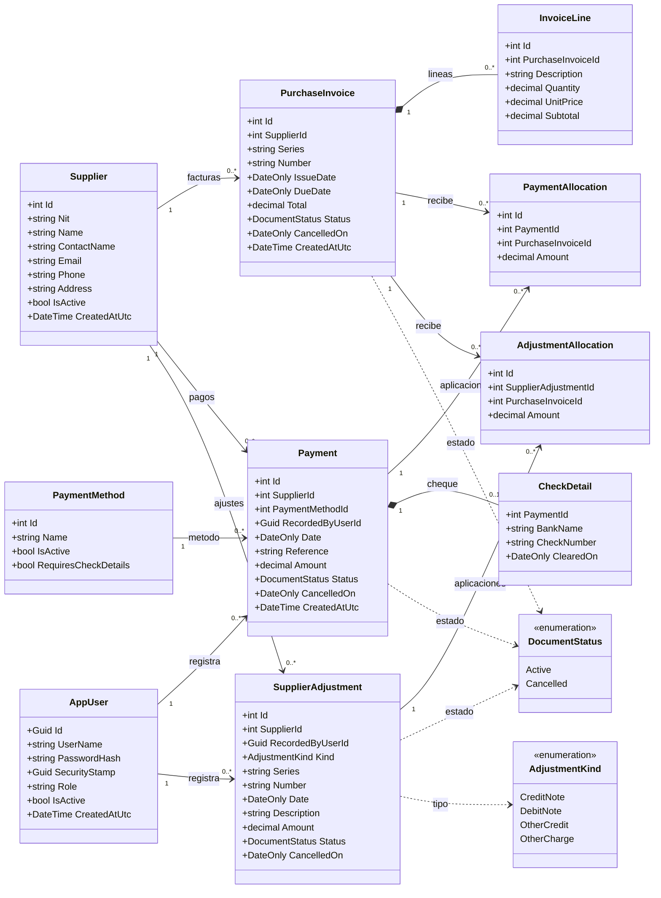

# Diagrama de clases — Sistema de Cuentas por Pagar

Este diagrama representa las **entidades implementadas** en el backend. Los nombres y las relaciones corresponden a `Models/` y a `Contexts/PayablesDbContext.cs`. Los saldos se calculan a partir de documentos y aplicaciones; no son campos editables de estas clases.

## Cómo leer la relación entre pagos y facturas

`PaymentAllocation` es la **entidad intermedia** entre `Payment` y `PurchaseInvoice`: un pago se puede distribuir entre varias facturas y una factura puede recibir varios pagos. `AdjustmentAllocation` cumple el mismo papel para las notas de crédito, notas de débito y otros ajustes. Cada aplicación guarda su importe. Las reglas de la API exigen al menos una línea por factura y una aplicación por pago o ajuste, aunque las colecciones aparecen como `0..*` porque esa es la cardinalidad estructural de las relaciones de EF Core.

`PaymentMethod` incluye el valor inicial `Cheque` y marca si el método exige `CheckDetail` (banco, número y fecha de cobro opcional). `SupplierAdjustment.Kind` distingue notas de crédito, notas de débito, otros abonos y otros cargos. Una nota se aplica por completo a facturas del mismo proveedor. El estado de cuenta es una respuesta calculada con facturas, pagos y ajustes; no existe una tabla que duplique esos movimientos.

Una factura activa tiene saldo `Total + Débitos - Créditos - Pagos`. `CancelledOn` permite registrar el contramovimiento en la fecha de anulación y conservar las consultas de cortes anteriores. Los documentos anulados antes de esta migración carecen de fecha histórica de anulación y no se pueden reconstruir retrospectivamente.
