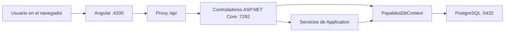

# Cuentas por pagar

Aplicación web del curso **Desarrollo Web** para registrar proveedores, facturas de compra, pagos y estados de cuenta. Es un monorepositorio: la API usa **ASP.NET Core Web API con .NET 10**, los datos se guardan en **PostgreSQL 17 dentro de Docker** durante el desarrollo y la interfaz usa **Angular 21**. Para publicar se preparó **Neon Free + Render Free + Vercel Hobby**. Cada integrante puede tener su propia base local.

## Contenido

1. [Cómo funciona el sistema](#cómo-funciona-el-sistema)
2. [Backend: estructura y código](#backend-estructura-y-código)
3. [Backend: base de datos y reglas](#backend-base-de-datos-y-reglas)
4. [Backend: API y seguridad](#backend-api-y-seguridad)
5. [Ejecutar PostgreSQL y la API](#ejecutar-postgresql-y-la-api)
6. [Comprobar el backend](#comprobar-el-backend)
7. [Frontend: estructura y código](#frontend-estructura-y-código)
8. [Ejecutar Angular](#ejecutar-angular)
9. [Publicar en la web](docs/despliegue.md)
10. [Diagrama de clases implementadas](DIAGRAMA_CLASES.md)

## Cómo funciona el sistema

El navegador abre Angular en `http://localhost:4200`. Angular envía solicitudes a rutas `/api/v1`; durante el desarrollo, su proxy las reenvía a la API en `https://localhost:7292`. Un controlador recibe cada solicitud, usa un servicio de aplicación o el contexto de Entity Framework Core y devuelve JSON. `PayablesDbContext` convierte las consultas y los cambios de entidades en operaciones de PostgreSQL.



La API es la responsable de validar permisos y reglas de negocio. Las validaciones de los formularios Angular ayudan al usuario, pero la API vuelve a comprobar los datos antes de guardarlos.

## Backend: estructura y código

La solución está en [`CuentasPorPagarAPI/CuentasPorPagarAPI.slnx`](CuentasPorPagarAPI/CuentasPorPagarAPI.slnx); el proyecto ejecutable está en [`CuentasPorPagarAPI/CuentasPorPagarAPI/`](CuentasPorPagarAPI/CuentasPorPagarAPI). Sigue la organización de `Contexts`, `Controllers`, `Models` y `Migrations` usada en clase:

| Archivo o carpeta | Responsabilidad |
| --- | --- |
| [`Program.cs`](CuentasPorPagarAPI/CuentasPorPagarAPI/Program.cs) | Arranca la API, lee la configuración, registra dependencias y ordena los componentes HTTP. |
| [`Contexts/`](CuentasPorPagarAPI/CuentasPorPagarAPI/Contexts) | Contiene el `DbContext` y la fábrica que utiliza `dotnet ef`. |
| [`Models/`](CuentasPorPagarAPI/CuentasPorPagarAPI/Models) | Entidades de la base, una clase por archivo, más roles y estado de documentos. |
| [`Migrations/`](CuentasPorPagarAPI/CuentasPorPagarAPI/Migrations) | Cambios versionados del esquema SQL y el snapshot del modelo EF Core. |
| [`Controllers/`](CuentasPorPagarAPI/CuentasPorPagarAPI/Controllers) | Rutas HTTP, entrada de datos, autorización y códigos de respuesta. |
| [`Application/`](CuentasPorPagarAPI/CuentasPorPagarAPI/Application) | Reglas de facturas, pagos, reportes, autenticación y tratamiento de errores. |
| [`Contracts/ApiContracts.cs`](CuentasPorPagarAPI/CuentasPorPagarAPI/Contracts/ApiContracts.cs) | Tipos de solicitud y respuesta; separan el JSON público de las entidades EF. |
| [`appsettings.json`](CuentasPorPagarAPI/CuentasPorPagarAPI/appsettings.json) y [`appsettings.Development.json`](CuentasPorPagarAPI/CuentasPorPagarAPI/appsettings.Development.json) | Valores generales, CORS y registros de desarrollo; las claves privadas se suministran aparte. |
| [`Properties/launchSettings.json`](CuentasPorPagarAPI/CuentasPorPagarAPI/Properties/launchSettings.json) | Perfiles `http` y `https` para Visual Studio y `dotnet run`. |
| [`CuentasPorPagarAPI.http`](CuentasPorPagarAPI/CuentasPorPagarAPI/CuentasPorPagarAPI.http) | Solicitudes de ejemplo para probar login, proveedores y resumen desde Visual Studio. |
| [`CuentasPorPagarAPI.csproj`](CuentasPorPagarAPI/CuentasPorPagarAPI/CuentasPorPagarAPI.csproj) | Versión de .NET y paquetes: EF Core PostgreSQL, JWT, OpenAPI y otros. |

### Qué hace `Program.cs`

1. Obtiene `ConnectionStrings:DefaultConnection` y registra `PayablesDbContext` con `UseNpgsql`. Registra también los servicios de facturas, pagos, reportes y el hasher de contraseñas.
2. Lee `Jwt:Issuer`, `Jwt:Audience` y `Jwt:Key`. Exige una clave de al menos 32 bytes, configura la validación de firma, emisor, destinatario y vencimiento, y registra autorización.
3. En cada solicitud autenticada consulta el usuario en PostgreSQL. Rechaza tokens de cuentas inactivas, con rol cambiado o con un `SecurityStamp` distinto. Así, cambiar la contraseña o el estado invalida tokens anteriores.
4. Limita el login a 10 intentos por dirección IP y minuto. Configura CORS con `Cors:AllowedOrigins`, redirección HTTP a HTTPS y respuestas de error.
5. Publica los controladores, `/health/live` para comprobar que el proceso responde y `/health/ready` para comprobar la conexión a PostgreSQL. En desarrollo publica el documento OpenAPI en `/openapi/v1.json`.
6. Con el argumento `--seed-admin` ejecuta `AdminSeeder` y termina; sin ese argumento inicia el servidor. **No aplica migraciones automáticamente.**

## Backend: base de datos y reglas

### `PayablesDbContext` y code-first

[`Contexts/PayablesDbContext.cs`](CuentasPorPagarAPI/CuentasPorPagarAPI/Contexts/PayablesDbContext.cs) **hereda de `DbContext`**. Sus propiedades `DbSet<T>` representan usuarios, proveedores, métodos de pago, facturas, líneas, pagos, cheques, notas y aplicaciones a facturas. En `OnModelCreating` se definen claves, longitudes, precisión decimal, relaciones, índices y restricciones de SQL. El [diagrama de clases](DIAGRAMA_CLASES.md) muestra las relaciones implementadas.

[`Contexts/PayablesDbContextFactory.cs`](CuentasPorPagarAPI/CuentasPorPagarAPI/Contexts/PayablesDbContextFactory.cs) crea el mismo contexto para las herramientas de diseño de EF Core. Lee la conexión desde User Secrets o variables de entorno para que `dotnet ef` pueda generar y aplicar migraciones.

| Modelo | Qué representa y cómo se relaciona |
| --- | --- |
| [`AppUser`](CuentasPorPagarAPI/CuentasPorPagarAPI/Models/AppUser.cs) | Cuenta de acceso con identificador GUID, nombre, hash de contraseña, rol, estado activo y `SecurityStamp`. El hash nunca se devuelve al frontend. |
| [`Supplier`](CuentasPorPagarAPI/CuentasPorPagarAPI/Models/Supplier.cs) | Proveedor con NIT y datos de contacto; puede tener muchas facturas y pagos. |
| [`PaymentMethod`](CuentasPorPagarAPI/CuentasPorPagarAPI/Models/PaymentMethod.cs) | Catálogo de métodos; EF inserta inicialmente Efectivo, Transferencia y Cheque. |
| [`PurchaseInvoice`](CuentasPorPagarAPI/CuentasPorPagarAPI/Models/PurchaseInvoice.cs) | Factura asociada a un proveedor, con fechas, total, líneas y aplicaciones de pago. |
| [`InvoiceLine`](CuentasPorPagarAPI/CuentasPorPagarAPI/Models/InvoiceLine.cs) | Concepto de una factura: descripción, cantidad, precio unitario y subtotal. |
| [`Payment`](CuentasPorPagarAPI/CuentasPorPagarAPI/Models/Payment.cs) | Pago asociado a proveedor, método y usuario que lo registró. |
| [`PaymentAllocation`](CuentasPorPagarAPI/CuentasPorPagarAPI/Models/PaymentAllocation.cs) | Parte de un pago aplicada a una factura. Permite pagar varias facturas con un movimiento. |
| [`CheckDetail`](CuentasPorPagarAPI/CuentasPorPagarAPI/Models/CheckDetail.cs) | Banco, número y fecha de cobro opcional de un pago con método de cheque. |
| [`SupplierAdjustment`](CuentasPorPagarAPI/CuentasPorPagarAPI/Models/SupplierAdjustment.cs) | Nota de crédito, nota de débito, otro cargo u otro abono de un proveedor. |
| [`AdjustmentAllocation`](CuentasPorPagarAPI/CuentasPorPagarAPI/Models/AdjustmentAllocation.cs) | Importe de una nota o ajuste aplicado a una factura. |
| [`DocumentStatus`](CuentasPorPagarAPI/CuentasPorPagarAPI/Models/DocumentStatus.cs) y [`Roles`](CuentasPorPagarAPI/CuentasPorPagarAPI/Models/Roles.cs) | Estados `Active`/`Cancelled` y roles `Administrador`/`Operador` usados en reglas y permisos. |

El **saldo de una factura activa** se calcula como `total + débitos − créditos − pagos`. Las notas y los pagos se aplican por completo a facturas del mismo proveedor; no se guarda una segunda columna de saldo. Las anulaciones nuevas registran su fecha para que un corte previo conserve el movimiento original. Los documentos anulados antes de la migración no tienen fecha histórica de anulación.

#### Migraciones existentes

- `20261026143248_InitialPostgres` crea tablas, relaciones, índices, restricciones, métodos de pago iniciales y el sello de seguridad de usuarios. Sustituye las migraciones antiguas de SQL Server porque se inicia una base PostgreSQL vacía.
- `20261027050936_ExpandMovements` añade notas y aplicaciones, detalles de cheques y fecha de anulación a facturas y pagos. Conserva los registros existentes.
- `PayablesDbContextModelSnapshot.cs` describe el modelo vigente que EF compara al crear la siguiente migración.

El historial de migraciones aplicadas se guarda en `__EFMigrationsHistory` de cada base. Para cambiar el esquema, modifica el modelo o `OnModelCreating` y, desde la carpeta del proyecto .NET, ejecuta:

```powershell
dotnet ef migrations add NombreDelCambio --output-dir Migrations
dotnet ef database update
```

Revisa el código generado antes de aplicarlo, especialmente si cambia o elimina columnas con datos. Mover archivos entre carpetas no requiere una migración cuando el modelo SQL no cambia.

### Servicios y reglas de negocio

| Servicio | Lógica principal |
| --- | --- |
| [`InvoiceService.cs`](CuentasPorPagarAPI/CuentasPorPagarAPI/Application/InvoiceService.cs) | Valida proveedor activo, fechas, serie/número únicos y al menos una línea. Calcula el total, pagos, débitos, créditos y saldo. Impide editar una factura que haya tenido movimientos y anularla mientras tenga aplicaciones activas. |
| [`PaymentService.cs`](CuentasPorPagarAPI/CuentasPorPagarAPI/Application/PaymentService.cs) | Valida proveedor, método, fecha, importes y saldo disponible después de notas. Exige banco y número si el método requiere cheque. Crea y anula pagos con transacción serializable. |
| [`AdjustmentService.cs`](CuentasPorPagarAPI/CuentasPorPagarAPI/Application/AdjustmentService.cs) | Registra notas de crédito, notas de débito y otros ajustes; exige aplicaciones completas a facturas del mismo proveedor y evita abonos que superen el saldo. |
| [`PayableQuery.cs`](CuentasPorPagarAPI/CuentasPorPagarAPI/Application/PayableQuery.cs) | Reúne pagos, débitos y créditos aplicados para calcular saldos por factura a una fecha. |
| [`ReportService.cs`](CuentasPorPagarAPI/CuentasPorPagarAPI/Application/ReportService.cs) | Calcula indicadores, facturas pendientes, balances agrupados por proveedor y estados de cuenta. Incluye facturas, pagos, notas, ajustes y contramovimientos por anulaciones fechadas. |
| [`AdminSeeder.cs`](CuentasPorPagarAPI/CuentasPorPagarAPI/Application/AdminSeeder.cs) | Crea **solo el primer administrador** si aún no hay usuarios. Lee nombre y contraseña de la configuración y guarda un hash, nunca la contraseña. |
| [`JwtTokenService.cs`](CuentasPorPagarAPI/CuentasPorPagarAPI/Application/JwtTokenService.cs) | Firma tokens JWT de ocho horas con identificador, usuario, rol y sello de seguridad. |
| [`ApiException.cs`](CuentasPorPagarAPI/CuentasPorPagarAPI/Application/ApiException.cs) y [`ApiExceptionHandler.cs`](CuentasPorPagarAPI/CuentasPorPagarAPI/Application/ApiExceptionHandler.cs) | Convierten errores de negocio y conflictos de SQL en respuestas `ProblemDetails`; registran errores inesperados y devuelven HTTP 500. |

Las operaciones financieras se validan en el backend incluso si Angular ya validó el formulario. Las lecturas usan `AsNoTracking` cuando no necesitan modificar entidades. Los listados de facturas, pagos, proveedores y cuentas por pagar devuelven `PageResult<T>` con `items`, `total`, `page` y `pageSize`; el tamaño máximo es 100.

## Backend: API y seguridad

Los [contratos HTTP](CuentasPorPagarAPI/CuentasPorPagarAPI/Contracts/ApiContracts.cs) definen campos de entrada y salida. Por ejemplo, `InvoiceRequest` trae conceptos sin subtotal ni total porque el backend los calcula; `InvoiceResponse` añade total, pagado y saldo. Las fechas viajan como `YYYY-MM-DD` y los importes usan decimales en PostgreSQL.

Todas las rutas de negocio están bajo `/api/v1`. Salvo `POST /auth/login`, las rutas de los controladores requieren `Authorization: Bearer <token>`. Los dos endpoints `/health` permiten comprobar el proceso y la base sin iniciar sesión.

| Controlador | Rutas principales | Permisos y propósito |
| --- | --- | --- |
| [`AuthController`](CuentasPorPagarAPI/CuentasPorPagarAPI/Controllers/AuthController.cs) | `POST /auth/login`; `GET /auth/me` | Login devuelve token, vencimiento y usuario; `me` devuelve el usuario del token y sirve para restaurar sesión. |
| [`UsersController`](CuentasPorPagarAPI/CuentasPorPagarAPI/Controllers/UsersController.cs) | `GET /users`, `GET /users/{id}`, `POST /users`, `PUT /users/{id}/password`, `PUT /users/{id}/status` | Solo Administrador. Crea cuentas, restablece contraseñas y activa o desactiva usuarios; impide desactivar la propia cuenta. |
| [`SuppliersController`](CuentasPorPagarAPI/CuentasPorPagarAPI/Controllers/SuppliersController.cs) | `GET /suppliers`, `GET /suppliers/{id}`, `POST /suppliers`, `PUT /suppliers/{id}`, `PUT /suppliers/{id}/status` | Usuarios autenticados consultan y editan; cambiar el estado requiere Administrador. La lista admite búsqueda, estado y paginación. |
| [`PaymentMethodsController`](CuentasPorPagarAPI/CuentasPorPagarAPI/Controllers/PaymentMethodsController.cs) | `GET /payment-methods`, `GET /payment-methods/{id}`, `POST /payment-methods`, `PUT /payment-methods/{id}`, `PUT /payment-methods/{id}/status` | Todos los autenticados consultan; solo Administrador crea, edita o cambia estado. |
| [`InvoicesController`](CuentasPorPagarAPI/CuentasPorPagarAPI/Controllers/InvoicesController.cs) | `GET /invoices`, `GET /invoices/{id}`, `POST /invoices`, `PUT /invoices/{id}`, `POST /invoices/{id}/cancel` | Gestiona facturas y consulta saldos. Todas las operaciones requieren iniciar sesión. |
| [`PaymentsController`](CuentasPorPagarAPI/CuentasPorPagarAPI/Controllers/PaymentsController.cs) | `GET /payments`, `GET /payments/{id}`, `POST /payments`, `POST /payments/{id}/cancel` | Registra abonos y datos de cheque si el método lo requiere; anular un pago requiere Administrador. |
| [`AdjustmentsController`](CuentasPorPagarAPI/CuentasPorPagarAPI/Controllers/AdjustmentsController.cs) | `GET /adjustments`, `GET /adjustments/{id}`, `POST /adjustments`, `POST /adjustments/{id}/cancel` | Gestiona notas y otros ajustes; la anulación requiere Administrador. |
| [`ReportsController`](CuentasPorPagarAPI/CuentasPorPagarAPI/Controllers/ReportsController.cs) | `GET /reports/dashboard`, `GET /reports/payables`, `GET /reports/supplier-balances`, `GET /reports/suppliers/{id}/statement`, `GET /reports/suppliers/{id}/statement.csv` | Resumen, pendientes, balance por proveedor y estado de cuenta; el último endpoint descarga CSV UTF-8. |

Ejemplo de flujo para registrar un pago:

1. Angular envía `POST /api/v1/payments` con proveedor, método, fecha, importe y aplicaciones a facturas.
2. El interceptor agrega el token JWT. `PaymentsController` obtiene el identificador del usuario autenticado y llama a `PaymentService`.
3. El servicio verifica reglas y saldos en una transacción; EF Core guarda `Payment` y sus `PaymentAllocation` en PostgreSQL.
4. La API devuelve `201 Created` y el frontend vuelve a consultar pagos y facturas para mostrar el saldo actualizado.

Las respuestas habituales son `200` para consultas y cambios, `201` al crear, `204` al anular o cambiar estados, `400` para datos inválidos, `401` para falta de autenticación, `403` por rol insuficiente, `404` si no existe el recurso y `409` ante conflictos de negocio o datos únicos. Consulta [`docs/api.md`](docs/api.md) para ejemplos JSON de las operaciones.

## Ejecutar PostgreSQL y la API

### Requisitos

- SDK **.NET 10** y herramienta `dotnet-ef` versión 10.
- Docker Desktop con PostgreSQL 17.
- Para el frontend: Node.js **20.19 o superior** y npm.
- Opcional: Visual Studio y DBeaver.

### 1. Iniciar la base local

Desde la raíz del repositorio, copia `.env.example` a `.env` y cambia `POSTGRES_PASSWORD` por una contraseña local fuerte:

```powershell
Copy-Item .env.example .env
docker compose up -d
```

[`compose.yaml`](compose.yaml) inicia PostgreSQL 17, publica solo `127.0.0.1:5432` y usa el volumen `postgres_data` para conservar datos entre reinicios. `.env` está ignorado por Git. Cada compañero puede usar su propia contraseña y base local. El volumen anterior de SQL Server no se borra automáticamente.

### 2. Configurar secretos de la API

Abre otra terminal en `CuentasPorPagarAPI/CuentasPorPagarAPI`. Sustituye los ejemplos por valores tuyos; la contraseña de la conexión debe coincidir con `POSTGRES_PASSWORD` de `.env`:

```powershell
dotnet user-secrets set "ConnectionStrings:DefaultConnection" "Host=127.0.0.1;Port=5432;Database=CuentasPorPagar;Username=cpp_local;Password=TU_CLAVE_LOCAL"
dotnet user-secrets set "Jwt:Key" "CLAVE_ALEATORIA_DE_AL_MENOS_32_BYTES"
dotnet user-secrets set "SeedAdmin:UserName" "admin"
dotnet user-secrets set "SeedAdmin:Password" "CLAVE_ADMIN_DE_AL_MENOS_12_CARACTERES"
```

User Secrets no forma parte del repositorio. La clave JWT debe tener al menos **32 bytes** y la contraseña inicial al menos **12 caracteres**. No escribas claves reales en `appsettings.json`, `README.md` ni archivos que se vayan a subir a GitHub.

### 3. Crear el esquema y el primer usuario

Desde esa misma carpeta:

```powershell
dotnet ef database update
dotnet run -- --seed-admin
```

El primer comando aplica las migraciones y crea la base si falta. El segundo crea el administrador y termina. `--seed-admin` es para la primera instalación: si ya hay usuarios, el seeder rechaza ejecutarse otra vez. Después puedes crear más cuentas desde la sección Configuración de Angular con un usuario Administrador.

En DBeaver usa el controlador PostgreSQL, host `127.0.0.1`, puerto `5432`, base `CuentasPorPagar`, usuario `cpp_local` y la contraseña de `.env`.

### 4. Iniciar la API

En Visual Studio abre `CuentasPorPagarAPI/CuentasPorPagarAPI.slnx`, selecciona el perfil **https** y pulsa **F5**. Como alternativa, desde la carpeta del proyecto:

```powershell
dotnet run --launch-profile https
```

El perfil escucha en `https://localhost:7292` y `http://localhost:5296`. HTTP redirige a HTTPS. Prueba `https://localhost:7292/health/live`: responde `{"status":"ok"}`. `https://localhost:7292/health/ready` responde `{"status":"ready"}` cuando PostgreSQL está accesible; de lo contrario devuelve `503`. En desarrollo puedes consultar `https://localhost:7292/openapi/v1.json`.

## Comprobar el backend

Desde la raíz, `dotnet build CuentasPorPagarAPI/CuentasPorPagarAPI.slnx` verifica la compilación. Con PostgreSQL y la API iniciados, `powershell -NoProfile -ExecutionPolicy Bypass -File .\scripts\smoke-api.ps1` ejecuta el [recorrido integrado](scripts/smoke-api.ps1): inicia sesión, crea proveedor, factura y pago de prueba, comprueba saldos y rechazo de sobrepago, anula los documentos y desactiva el proveedor temporal. **Este script escribe registros en la base local.**

`powershell -NoProfile -ExecutionPolicy Bypass -File .\scripts\verify-movements.ps1` comprueba facturas, notas, cheques, saldos por proveedor y anulaciones históricas en una base PostgreSQL **temporal**. Necesita Docker activo y los User Secrets locales del administrador; elimina la base temporal al terminar.

Para agregar una entidad o columna, cambia `Models/` y `PayablesDbContext`, crea una migración en `Migrations/` y aplícala en cada base local. Para agregar una operación HTTP, define sus datos en `Contracts/`, implementa las reglas en `Application/` cuando correspondan y expón la ruta en `Controllers/`.

## Frontend: estructura y código

La aplicación Angular está en [`frontend/`](frontend). Usa componentes independientes, rutas protegidas, formularios con `FormsModule` y `HttpClient` para comunicarse con la API.

| Archivo | Qué hace |
| --- | --- |
| [`package.json`](frontend/package.json) | Dependencias y comandos `npm start`, `npm run build`, `npm run watch` y `npm test`. |
| [`angular.json`](frontend/angular.json) | Configuración de compilación, servidor de desarrollo, estilos SCSS y recursos públicos. |
| [`src/index.html`](frontend/src/index.html) y [`src/main.ts`](frontend/src/main.ts) | Documento HTML con `<app-root>` y arranque de Angular mediante `bootstrapApplication`. |
| [`src/app/app.ts`](frontend/src/app/app.ts) | Componente raíz; contiene el `router-outlet` donde aparece la pantalla actual. |
| [`src/app/app.config.ts`](frontend/src/app/app.config.ts) | Registra rutas, `HttpClient` y el interceptor de autenticación. |
| [`src/app/app.routes.ts`](frontend/src/app/app.routes.ts) | Define `/ingresar`, la ruta protegida `/:section`, redirecciones y guard de autenticación. |
| [`src/app/models.ts`](frontend/src/app/models.ts) | Interfaces TypeScript de usuarios, proveedores, facturas, pagos, reportes y páginas; reflejan el JSON de `Contracts`. |
| [`src/app/api.service.ts`](frontend/src/app/api.service.ts) | Centraliza llamadas `GET`/`POST`/`PUT` a `/api/v1`, parámetros, paginación completa, CSV y mensajes de error. |
| [`src/app/auth.service.ts`](frontend/src/app/auth.service.ts) | Login, usuario actual, restauración de sesión, logout, rol Administrador e interceptor `Authorization: Bearer`. |
| [`src/app/login.component.ts`](frontend/src/app/login.component.ts) | Formulario de inicio de sesión, indicador de espera y errores. |
| [`src/app/workspace.component.ts`](frontend/src/app/workspace.component.ts) | Estado de la pantalla, carga de datos, formularios, acciones y navegación entre secciones. |
| [`src/app/workspace.component.html`](frontend/src/app/workspace.component.html) | Menú, tablas, formularios, indicadores y plantillas condicionales con `@if` y `@for`. |
| [`src/styles.scss`](frontend/src/styles.scss) | Colores, tipografía, componentes visuales y ajustes para pantallas pequeñas. |
| [`proxy.conf.json`](frontend/proxy.conf.json) | Reenvía `/api` a la API HTTPS local durante `npm start`. |

### Sesión, rutas y llamadas HTTP

`LoginComponent` envía usuario y contraseña a `AuthService.login()`. Este llama a `POST /api/v1/auth/login` a través de `ApiService`, guarda el token en `sessionStorage`, establece el usuario y navega a `/resumen`. El token dura hasta que se cierra la pestaña o se cierra sesión; el servidor también exige que siga vigente y que la cuenta continúe activa.

Al abrir una ruta protegida tras recargar la página, el guard de `app.routes.ts` espera `AuthService.restore()`. Si hay un token guardado, `restore()` consulta `GET /auth/me` para recuperar y validar al usuario. Si falla, borra la sesión y envía a `/ingresar`. El interceptor añade el token solo a peticiones de la API configurada. `isAdmin` controla qué acciones se muestran, pero los permisos reales los comprueba la API.

`ApiService.all()` recorre páginas de 100 registros hasta reunir los resultados; `blob()` descarga el CSV. `apiError()` transforma errores HTTP en mensajes legibles para los formularios.

### Secciones de `WorkspaceComponent`

La ruta `/:section` muestra una de estas secciones. El componente lee el parámetro, valida que exista en `nav` y llama a `load()` para solicitar los datos necesarios. `run()` gestiona el indicador `busy`, avisos y errores; si recibe `401`, cierra la sesión.

| Ruta | Comportamiento |
| --- | --- |
| `/resumen` | Consulta indicadores de `/reports/dashboard` y pendientes actuales; muestra saldo, facturas pendientes/vencidas, proveedores activos y próximos compromisos. |
| `/proveedores` | Busca localmente por nombre o NIT; crea y edita proveedores. Un Administrador puede activarlos o desactivarlos. |
| `/facturas` | Lista facturas y saldos; el formulario añade o quita conceptos y calcula un total de vista previa. La API calcula el total definitivo. Permite editar o anular conforme a las reglas del backend. |
| `/pagos` | Carga proveedores, facturas, métodos y pagos. Permite distribuir un pago entre facturas con saldo del mismo proveedor, consultar el detalle y, como Administrador, anularlo. |
| `/movimientos` | Registra notas de crédito, notas de débito y otros ajustes; permite consultar aplicaciones y anular documentos como Administrador. |
| `/reportes` | Filtra pendientes por fecha, muestra el balance agrupado por proveedor, consulta el estado de cuenta y descarga su CSV. |
| `/configuracion` | Lista métodos de pago. El Administrador puede gestionarlos y crear, activar, desactivar o cambiar la contraseña de usuarios. |

Los formularios usan `[(ngModel)]` para relacionar entradas con el estado TypeScript. La plantilla muestra avisos y deshabilita botones cuando corresponde. Los importes se presentan en **quetzales (GTQ)** mediante `Intl.NumberFormat('es-GT')`; esto afecta solo la presentación, no el cálculo decimal que hace el backend.

## Ejecutar Angular

En otra terminal, desde `frontend`:

```powershell
npm ci --legacy-peer-deps
npm run start
```

Abre `http://localhost:4200`. `npm start` ejecuta `ng serve --proxy-config proxy.conf.json`. El proxy envía `/api` directamente a `https://localhost:7292`; `secure: false` acepta el certificado HTTPS de desarrollo y `changeOrigin: true` adapta la cabecera de origen hacia la API. Si cambias `proxy.conf.json`, detén Angular con **Ctrl+C** y vuelve a iniciar `npm run start` para cargarlo de nuevo.

La API debe estar ejecutándose con el perfil **https**. Usar su puerto HTTP `5296` como destino del proxy provoca una redirección a HTTPS que puede perder el encabezado `Authorization`; por eso el proxy apunta al puerto `7292`. Para generar archivos listos para alojar, ejecuta `npm run build`: Angular escribe el resultado en `frontend/dist/`.

Para agregar otra sección del panel, amplía `nav`, `load()` y el bloque correspondiente de `workspace.component.html`; agrega interfaces en `models.ts` y usa `ApiService`. Para una página independiente, crea un componente y registra su ruta en `app.routes.ts`.

Para alojar Angular en Vercel Hobby, la API en Render Free y PostgreSQL en Neon Free, sigue la [guía paso a paso](docs/despliegue.md). La URL pública de la API se incorpora en la compilación de Angular mediante `API_BASE_URL`; Render debe permitir el origen exacto de Vercel mediante `Cors__AllowedOrigins__0`. Consulta también el [plan y análisis](docs/plan-proyecto.md) y el [contrato con ejemplos JSON](docs/api.md).
