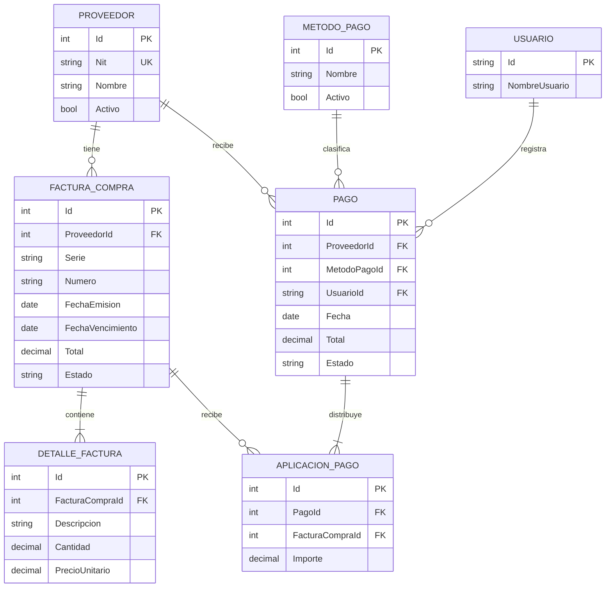
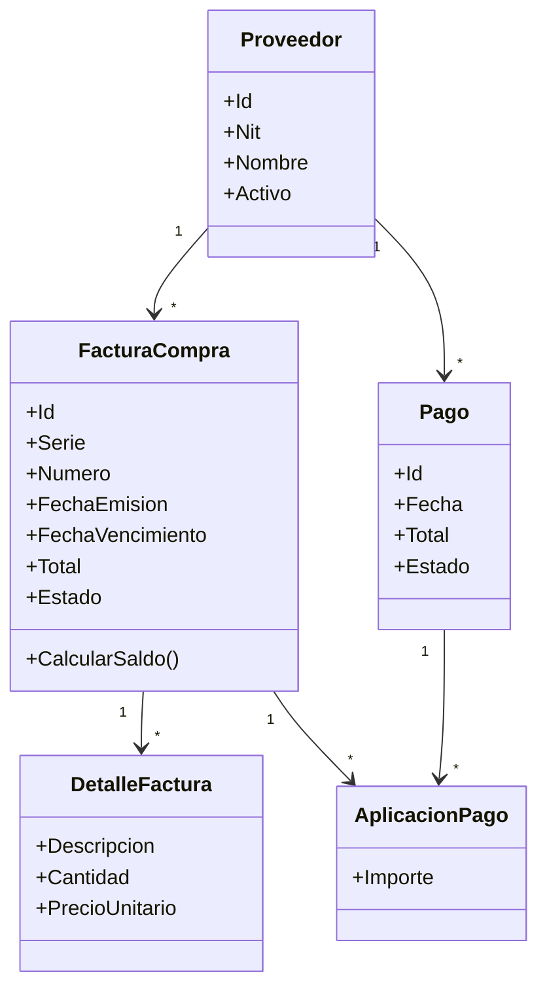

# Cuentas por pagar — análisis y plan inicial

**Fecha:** 21 de octubre de 2026

**Entrega indicada en la guía:** 31 de octubre de 2026

**Estado de este documento:** plan inicial conservado como registro histórico. El 26 de octubre se cambió la implementación a PostgreSQL local y Neon para producción, con Render y Vercel preparados para publicación. Sigue la [guía vigente de instalación y despliegue](despliegue.md); las menciones posteriores a SQL Server y Azure describen alternativas evaluadas, no la configuración actual.

## 1. Encargo del curso

Las fotografías de la guía asignan el proyecto **Cuentas por pagar** y exigen, como mínimo, proveedores, ingresos por compra (facturas), movimientos de pagos y estados de cuenta. También piden acceso de seguridad, menú principal, parámetros del sistema, movimientos o procesos, y consultas o reportes. La combinación que da 15 puntos es **Angular + ASP.NET Core Web API + MS SQL Server**.

La entrega incluye publicar la solución en la web; subir frontend y backend a GitHub; entregar documentación, video con participación de todo el equipo y enlaces en Canvas. El video debe durar 30 minutos con tolerancia de ±5 minutos. La documentación debe indicar el porcentaje de participación de cada integrante. El documento de análisis debe contener misión, objetivo general, requerimientos funcionales, reglas del negocio, alcances, límites, módulos funcionales, diagrama de clases, diagrama entidad-relación y cronograma.

## 2. Estado del repositorio

- Existe la solución `CuentasPorPagarAPI/CuentasPorPagarAPI.slnx`, que apunta a .NET 10.
- La API ya contiene modelo code-first, migraciones, autenticación, proveedores, facturas, pagos y reportes. El frontend se iniciará después de integrar Docker.
- Git está inicializado en la carpeta raíz; falta vincular un remoto de GitHub cuando el equipo lo cree.
- El equipo local tiene SDK .NET 10, Node 20.20.2, npm 10.8.2 y cliente Docker. Al revisar el 21 de octubre, el motor Docker no estaba iniciado o disponible; habrá que iniciar Docker Desktop antes de levantar SQL Server.

Estructura prevista, conservando la solución ya creada:

```text
FinalDesarrolloWeb/
├── CuentasPorPagarAPI/       # Solución y proyecto ASP.NET Core existentes
├── frontend/                 # Angular, a crear en la fase correspondiente
├── docs/                     # Análisis, diagramas, instalación y evidencias
├── .gitignore
└── README.md
```

Habrá **un repositorio Git en la raíz** y carpetas independientes para API y Angular. Un solo historial facilita coordinar cambios entre contratos HTTP, migraciones y pantallas.

## 3. Misión y objetivo

**Misión:** ayudar a un negocio pequeño a registrar sus obligaciones con proveedores y consultar cuánto debe, qué ha pagado y qué facturas están vencidas.

**Objetivo general:** desarrollar una aplicación web de cuentas por pagar que registre proveedores, facturas de compra y pagos, calcule saldos por factura y proveedor y permita consultar estados de cuenta, con acceso autenticado.

## 4. Requerimientos funcionales y alcance

- **RF-01:** iniciar sesión y restringir las operaciones según el rol.
- **RF-02:** administrar proveedores y consultar su historial.
- **RF-03:** registrar y consultar facturas de compra con sus conceptos y vencimiento.
- **RF-04:** registrar pagos y aplicarlos a facturas, incluidos abonos parciales.
- **RF-05:** mostrar saldos, facturas vencidas y estado de cuenta por proveedor.
- **RF-06:** consultar reportes por fechas y acceder a las funciones mediante un menú principal.
- **RF-07:** administrar los parámetros básicos del sistema, como los métodos de pago.

| Módulo | Funciones previstas |
| --- | --- |
| Seguridad | Inicio y cierre de sesión; roles Administrador y Operador; rutas y API protegidas. |
| Menú principal | Navegación y resumen de facturas pendientes, vencidas y saldo total. |
| Parámetros | Métodos de pago y configuración básica del negocio. |
| Proveedores | Alta, edición, listado, búsqueda y desactivación. |
| Facturas de compra | Registro con proveedor, serie/número, fechas, detalle de conceptos e importe; listado y consulta. |
| Pagos | Registro de pago y aplicación parcial o total a una o varias facturas del mismo proveedor. |
| Consultas y reportes | Estado de cuenta por proveedor y rango de fechas; facturas pendientes/vencidas; filtro y exportación CSV si alcanza el tiempo. |

**Límites para esta entrega:** no se incluye inventario, contabilidad general, integración con SAT, emisión fiscal, bancos, compras con órdenes de compra, ni flujo de aprobaciones. Los detalles de factura describen conceptos y sus importes; no administran existencias. El estado de cuenta se calcula a partir de facturas y pagos, en vez de mantener un saldo editable.

## 5. Reglas del negocio propuestas

1. El identificador fiscal del proveedor (NIT) es único, si se registra. Serie y número de factura son únicos por proveedor.
2. Una factura debe tener al menos un concepto; cantidad, precio, importe total y pagos son positivos. El total se calcula a partir de los conceptos al guardar. Se usan importes decimales, nunca `float`/`double`.
3. Un pago solo puede aplicarse a facturas del mismo proveedor. La suma de aplicaciones debe coincidir con el importe del pago.
4. Se permiten abonos parciales. El total aplicado a una factura nunca supera su total; el saldo se calcula como `total - pagos activos aplicados`.
5. Una factura pagada o con abonos no se elimina. Las anulaciones de facturas/pagos deben conservar el historial y ajustar el saldo; las operaciones de pago/anulación requieren transacción para evitar saldos inconsistentes.
6. Una factura se considera vencida si tiene saldo y su fecha de vencimiento ya pasó. Las fechas y filtros del reporte deben usar una zona horaria acordada para Guatemala.

**Decisiones por confirmar con el equipo:** formato exacto del NIT, manejo de impuestos/IVA y posibilidad de pagos anticipados. La versión mínima funciona sin pagos anticipados y con importes finales por concepto.

## 6. Modelo de datos inicial

| Entidad | Datos principales | Relación |
| --- | --- | --- |
| Proveedor | Id, NIT, nombre, contacto, estado | 1:N Factura y 1:N Pago |
| FacturaCompra | Id, proveedor, serie, número, emisión, vencimiento, total, estado | 1:N DetalleFactura y 1:N AplicacionPago |
| DetalleFactura | Id, factura, descripción, cantidad, precio unitario, subtotal | N:1 FacturaCompra |
| Pago | Id, proveedor, fecha, método, referencia, total, estado, usuario | 1:N AplicacionPago |
| AplicacionPago | Id, pago, factura, importe aplicado | N:1 Pago y N:1 FacturaCompra |
| MetodoPago | Id, nombre, activo | 1:N Pago |
| Usuario/Rol | Identidad y rol | ASP.NET Core Identity o equivalente integrado |



Diagrama de clases conceptual del plan inicial (el [diagrama de las clases implementadas](../DIAGRAMA_CLASES.md) está en la raíz del proyecto):



## 7. Arquitectura y contratos

```text
Angular (pantallas y rutas protegidas)
   → HTTPS/JSON
ASP.NET Core Web API (controladores → servicios/reglas → EF Core)
   → proveedor SQL Server
SQL Server Express en Docker
```

- Mantener **una sola API** con carpetas por función (`Auth`, `Proveedores`, `Facturas`, `Pagos`, `Reportes`) y capas simples de DTO, servicio y persistencia. Evitar dividir en muchos proyectos antes de tener el flujo completo.
- Usar **EF Core code-first** con migraciones versionadas y proveedor `Microsoft.EntityFrameworkCore.SqlServer`. Cada integrante podrá usar su propia instancia SQL Server Express local; la conexión se configura fuera del repositorio.
- Definir rutas versionadas `/api/v1/...`, validación de entrada, respuestas de error consistentes, paginación para listas y OpenAPI para documentar la API.
- Proteger la API con autenticación por token y roles; el frontend controla navegación, pero la API vuelve a verificar permisos. No se habilita registro público. Secretos y contraseñas iniciales quedan fuera del repositorio.
- Configurar CORS solo para el origen Angular desplegado y el origen local de desarrollo. Usar HTTPS en el despliegue.
- Probar especialmente unicidad de factura, pagos parciales, sobrepagos, anulación y cálculo de estado de cuenta. Para esas reglas se necesitan pruebas con una base SQL real o un contenedor, además de las pruebas unitarias que convengan.

## 8. Base de datos compartida y publicación

| Alternativa | Uso propuesto | Condición principal |
| --- | --- | --- |
| **SQL Server Express en Docker local** | Opción principal para desarrollo sin suscripción | Gratis para este uso; cada integrante puede ejecutarlo localmente. Para una instancia compartida, la computadora anfitriona debe permanecer encendida y los demás necesitan acceso por red local o VPN. Usar volumen persistente y `MSSQL_PID=Express`. |
| **Azure for Students** | Alternativa condicional si el equipo decide usar Azure después | Es una suscripción con USD 100 de crédito por 12 meses, sin tarjeta al registrarse. Permite crear servicios como Azure SQL Database; si se acaba el crédito o vence y no se pasa expresamente a pago por uso, la suscripción se desactiva/cancela. **Starter** tiene otras restricciones. |
| **Azure SQL Database, oferta gratuita estándar** | Descartada por decisión del usuario | Aunque se puede configurar para pausar al agotar la cuota, requiere una suscripción Azure; no se planificará como primera opción. |

**Decisión actual:** preparar SQL Server Express en Docker y migraciones EF Core. DBeaver se conecta directamente a la instancia mediante host, puerto y credenciales. Durante el desarrollo, cada integrante puede tener su base local reproducible; para pruebas comunes se puede compartir una instancia mediante VPN privada. Tailscale Personal ofrece actualmente hasta seis usuarios sin costo para uso personal/no comercial; hay que verificar que el tamaño y uso del grupo encajen. Un puerto SQL publicado hacia Internet no forma parte del plan.

**Para usar Docker con el grupo:** (1) iniciar Docker Desktop y levantar SQL Server Express con volumen persistente, clave fuerte y puerto local; (2) aplicar las migraciones y datos de ejemplo; (3) cada compañero puede reproducir la base en su computadora con el mismo archivo Compose y migraciones de Git; (4) si se necesita una base común, conectar las computadoras a la misma red local o a una VPN privada y permitir en el firewall solo el acceso necesario al puerto SQL. En DBeaver se usa `localhost:1433` en la máquina anfitriona o la IP privada/VPN de ella en las otras. La máquina anfitriona debe quedar encendida. Hacer copias de seguridad; el volumen evita perder datos al recrear el contenedor, pero no reemplaza el respaldo.

**Si se reconsidera Azure for Students:** un integrante elegible crea la suscripción estudiantil, aprovisiona Azure SQL Database dentro de esa suscripción y configura firewall, usuarios y secretos. Los demás pueden conectarse desde DBeaver con permisos e IP autorizados; no necesitan administrar la suscripción para consultar la base. Azure SQL es el servicio de base de datos que consumiría el crédito estudiantil, así que esta alternativa aún depende de Azure. Mantener la suscripción estudiantil sin conversión a pago por uso evita la facturación automática al agotarse el crédito según la documentación de Microsoft, pero el servicio dejaría de funcionar en ese momento.

**Publicación pendiente de resolver:** un Angular publicado necesita una API accesible por HTTPS, y esa API debe poder alcanzar SQL Server. Si la base y la API quedan en una computadora del equipo, el sistema solo estará disponible mientras esa computadora y su conexión estén activas. Alojar solo Angular en un servicio estático no cumple el recorrido completo de la aplicación.

**Secuencia acordada:** completar la API y generar las migraciones code-first; después levantar SQL Server Express local en Docker para cada integrante y aplicar las migraciones; finalmente desarrollar Angular. Si más adelante se necesita una instancia común, se habilitará el acceso mediante Tailscale.

## 9. Cronograma corto

| Fechas de 2026 | Resultado verificable |
| --- | --- |
| 21–26 oct | Completar API: seguridad, proveedores, facturas, pagos, reportes y migraciones code-first. |
| 27 oct | Levantar SQL Server Express con Docker en cada computadora, aplicar migraciones y probar integración. |
| 28–29 oct | Crear Angular: acceso, menú, formularios y consultas; integrar con la API. |
| 30 oct | Despliegue web, recorrido completo, correcciones, documentación y video de 25–35 min. |
| 31 oct | Presentación y enlaces finales en Canvas. |

El hito principal es un recorrido demostrable: iniciar sesión → crear proveedor → registrar factura → abonar → consultar saldo/estado de cuenta.

## 10. Fuentes técnicas consultadas

- [Oferta gratuita de Azure SQL Database](https://learn.microsoft.com/en-us/azure/azure-sql/database/free-offer?view=azuresql) y [preguntas frecuentes, incluidas suscripciones estudiantiles](https://learn.microsoft.com/en-us/azure/azure-sql/database/free-offer-faq?view=azuresql).
- [Azure for Students](https://learn.microsoft.com/en-us/azure/education-hub/about-azure-for-students).
- [Qué sucede al agotarse el crédito de Azure for Students](https://learn.microsoft.com/en-us/azure/education-hub/faq) y [reglas de firewall para conexiones Azure SQL](https://learn.microsoft.com/en-us/azure/azure-sql/database/firewall-create-server-level-portal-quickstart?view=azuresql).
- [Proveedor EF Core para SQL Server y Azure SQL](https://learn.microsoft.com/en-us/ef/core/providers/sql-server/).
- [SQL Server en contenedores](https://learn.microsoft.com/en-us/sql/linux/sql-server-linux-docker-container-deployment?view=sql-server-ver17) y [variable de edición Express](https://learn.microsoft.com/en-us/sql/linux/sql-server-linux-configure-environment-variables?view=sql-server-linux-ver17).
- [Volúmenes persistentes de SQL Server](https://learn.microsoft.com/en-us/sql/linux/sql-server-linux-docker-container-configure), [publicación de puertos en Docker Desktop](https://docs.docker.com/desktop/features/networking/) y [Tailscale Personal](https://tailscale.com/pricing).
- [Licencia de Docker Desktop para educación](https://docs.docker.com/subscription-billing/desktop-license).
- [Azure Static Web Apps para Angular](https://learn.microsoft.com/en-us/azure/static-web-apps/deploy-angular) y [App Service para ASP.NET Core con plan F1](https://learn.microsoft.com/en-us/azure/app-service/quickstart-dotnetcore).
- [Conexión SQL Server/Azure SQL en DBeaver](https://dbeaver.com/docs/dbeaver/Database-driver-Microsoft-SQL-Server/).

## 11. Ampliación tras la revisión del catedrático

El plan anterior refleja la primera versión. La implementación actual añade un módulo de notas de crédito, notas de débito y otros cargos o abonos. Cada documento se aplica por completo a una o más facturas del mismo proveedor mediante `AdjustmentAllocation`. La relación muchos a muchos entre pagos y facturas ya existía mediante `PaymentAllocation`. Los pagos con método de cheque registran banco, número y fecha de cobro opcional.

El saldo de cada factura activa se calcula como `total + débitos − créditos − pagos`. El estado de cuenta une facturas, pagos, notas y contramovimientos fechados; el reporte `/reports/supplier-balances` agrupa cuánto se debe a cada proveedor a una fecha. La interfaz Angular ofrece formularios de notas y cheques y muestra el balance agrupado. El [diagrama de clases vigente](../DIAGRAMA_CLASES.md) y el [contrato de la API](api.md) documentan estas funcionalidades.

**Reglas adoptadas:** importes en quetzales con dos decimales; pagos y notas se aplican por completo a facturas existentes; no se permiten créditos que dejen una factura con saldo negativo; solo el Administrador puede anular pagos y ajustes. Las anulaciones nuevas se registran en la fecha local de Guatemala y producen un contramovimiento. Esta versión no gestiona anticipos ni créditos sin aplicar. Los documentos anulados antes de la migración carecen de fecha histórica de anulación.

La verificación repetible `scripts/verify-movements.ps1` crea una base PostgreSQL temporal, aplica migraciones, registra una factura, notas y un cheque, compara los saldos y comprueba una anulación con corte histórico; elimina esa base al finalizar. Antes de la entrega deben completar la evidencia del video y el porcentaje de participación de cada integrante.
